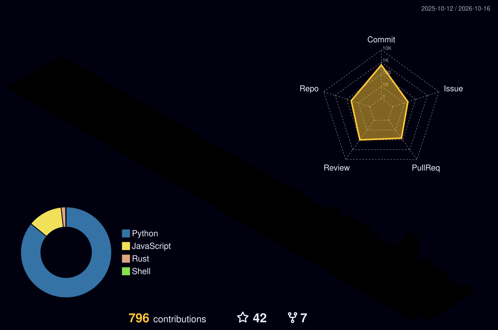

<table width="100%" cellspacing="0" cellpadding="0">
<tr>
<td valign="middle" width="62%">

<strong>Artificial Intelligence</strong><br>
I build around AI: tools, systems, and experiments that turn vague ideas into usable workflows.<br><br>
<strong>Tools & Systems</strong><br>
I care about the moment when intelligence stops being only a chat box and starts becoming something that can plan, call tools, remember context, and help with real work.<br><br>
<strong>Open Questions</strong><br>
How should humans collaborate with AI when the answer is not only text, but also an action, a process, or a small system?

</td>
<td valign="top" width="38%">
<p align="center">
<strong>Human × AI, not Human vs. AI</strong><br>
<br>
<em>Turning ideas into working systems</em>
</p>
</td>
</tr>
</table>

<table width="100%" cellspacing="0" cellpadding="0">
<tr>
<td valign="top" width="100%">

[](https://www.python.org/)
[](https://github.com/jyh20030112)
[](https://github.com/jyh20030112)

<!--START_SECTION:profile-stats-->
Based on **564** public commits authored by [@jyh20030112](https://github.com/jyh20030112):

<table width="100%" cellspacing="0" cellpadding="0">
<tr>
<th align="center">Most Active Time</th>
<th align="center">Most Productive Day</th>
<th align="center">Primary Language</th>
</tr>
<tr>
<td align="center">🌆 18–24</td>
<td align="center">Wednesday</td>
<td align="center">Python</td>
</tr>
</table>

<strong>Time Distribution</strong>

```text
🌙 00–08  64 commits  █████░░░░░░░░░░░░░░░░░░░░░░░░░░░░░░░░░░░░░░░░░░░░░   11.3 %
🌞 08–12  92 commits  ████████░░░░░░░░░░░░░░░░░░░░░░░░░░░░░░░░░░░░░░░░░░   16.3 %
🌤️ 12–18  176 commits ███████████████░░░░░░░░░░░░░░░░░░░░░░░░░░░░░░░░░░░   31.2 %
🌆 18–24  232 commits ████████████████████░░░░░░░░░░░░░░░░░░░░░░░░░░░░░░   41.1 %
```

<strong>Weekday Distribution</strong>

```text
🐔 Monday     89 commits  ███████░░░░░░░░░░░░░░░░░░░░░░░░░░░░░░░░░░░░░░░░░░░   15.8 %
🐱 Tuesday    94 commits  ████████░░░░░░░░░░░░░░░░░░░░░░░░░░░░░░░░░░░░░░░░░░   16.7 %
🐶 Wednesday  103 commits █████████░░░░░░░░░░░░░░░░░░░░░░░░░░░░░░░░░░░░░░░░░   18.3 %
🐮 Thursday   79 commits  ███████░░░░░░░░░░░░░░░░░░░░░░░░░░░░░░░░░░░░░░░░░░░   14.0 %
🐯 Friday     87 commits  ███████░░░░░░░░░░░░░░░░░░░░░░░░░░░░░░░░░░░░░░░░░░░   15.4 %
🐰 Saturday   50 commits  ████░░░░░░░░░░░░░░░░░░░░░░░░░░░░░░░░░░░░░░░░░░░░░░    8.9 %
🐲 Sunday     62 commits  █████░░░░░░░░░░░░░░░░░░░░░░░░░░░░░░░░░░░░░░░░░░░░░   11.0 %
```

<strong>Language Distribution</strong>

```text
Python      272,282 lines ████████████████████████████████████████░░░░░░░░░░   81.4 %
TypeScript  26,846 lines  ████░░░░░░░░░░░░░░░░░░░░░░░░░░░░░░░░░░░░░░░░░░░░░░    8.0 %
JavaScript  24,839 lines  ███░░░░░░░░░░░░░░░░░░░░░░░░░░░░░░░░░░░░░░░░░░░░░░░    7.4 %
Other       10,328 lines  █░░░░░░░░░░░░░░░░░░░░░░░░░░░░░░░░░░░░░░░░░░░░░░░░░    3.1 %
```
<!--END_SECTION:profile-stats-->

</td>
</tr>
</table>

<table width="100%" cellspacing="0" cellpadding="0">
<tr>
<td valign="top" width="34%">

<strong>Direction</strong><br>
AI as a material for building.<br>
Not only prompts, not only models, but interfaces, tools, memory, workflows, and the quiet parts that make intelligence useful.

</td>
<td valign="top" width="33%">

<strong>Experiments</strong><br>
Small systems first.<br>
I like projects that can be touched, run, broken, repaired, and slowly shaped into something clearer.

</td>
<td valign="top" width="33%">


</td>
</tr>
</table>

<details>
<summary>About the activity stats</summary>

Commit counts include all public commits authored by this GitHub account. Language distribution is weighted by additions and deletions in code files changed by those commits; generated files, lockfiles, dependencies, and non-code assets are excluded.

</details>

<p align="right">Building with AI, one small system at a time.</p>
